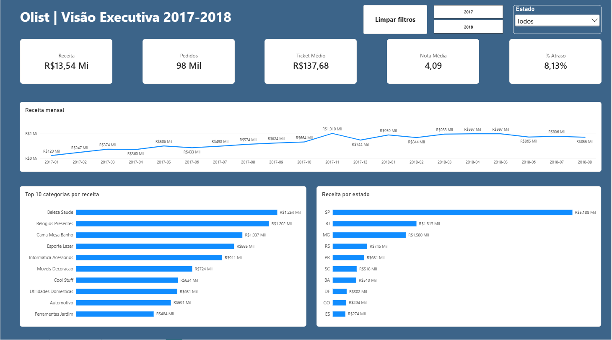
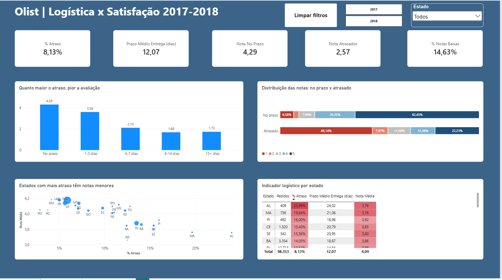

# Olist | Análise de Vendas, Logística e Satisfação (Power BI)

Dashboard em Power BI com dados reais e anonimizados do e-commerce brasileiro **Olist**, com ~98 mil pedidos entre 2017 e 2018. Fonte: [Olist no Kaggle](https://www.kaggle.com/datasets/olistbr/brazilian-ecommerce).

**Pergunta de negócio:** o que sustenta a receita da operação e quanto o atraso na entrega afeta a satisfação do cliente?




---

## Principais achados

**Vendas**
- **R$ 13,54 Mi** de receita, **~98 mil pedidos** e ticket médio de **R$ 137,68** (jan/2017 a ago/2018)
- **SP concentra ~38% da receita.** SP, RJ e MG somam ~63%
- **Black Friday:** novembro/2017 foi o maior mês do período (R$ 1,01 Mi), **~52% acima** de outubro
- Categorias líderes: Beleza & Saúde, Relógios & Presentes e Cama, Mesa & Banho, cada uma com mais de R$ 1 Mi

**Logística x Satisfação**
- **8,13%** dos pedidos chegam atrasados, com prazo médio de entrega de **12 dias**
- Nota média: **4,29 para entregas no prazo** contra **2,57 para atrasadas**
- **46% dos pedidos atrasados recebem nota 1**, contra 6,6% dos entregues no prazo (cerca de 7 vezes mais)
- Basta 1 a 3 dias de atraso para a nota cair de 4,29 para 3,59. Com 4 a 7 dias, ela cai para 2,10
- **AL (24%) e MA (20%)** têm 2,5 a 3 vezes o atraso médio nacional, prazo médio acima de 20 dias e as menores notas

## Recomendações
1. **Priorizar a malha logística do Norte e Nordeste**, onde atraso e insatisfação se concentram
2. **Comunicação proativa** quando houver risco de atraso, já que até 1 a 3 dias derrubam a avaliação
3. **Revisar a data estimada de entrega** por região, prometendo prazos mais realistas onde o histórico de atraso é alto

---

## Como foi feito

**Fonte dos dados:** [Brazilian E-Commerce Public Dataset by Olist](https://www.kaggle.com/datasets/olistbr/brazilian-ecommerce), disponibilizado pela **Olist** no **Kaggle** sob a licença [CC BY-NC-SA 4.0](https://creativecommons.org/licenses/by-nc-sa/4.0/). São dados reais e anonimizados de pedidos feitos na Olist entre 2016 e 2018, em 9 tabelas CSV. Os CSV não estão neste repositório e podem ser baixados direto no Kaggle.

**Tratamento (Power Query)**
- Importação dos CSV com codificação UTF-8 e localidade `en-US`, para ler corretamente decimais com ponto
- Colunas derivadas: data do pedido, dias de entrega e flag de atraso (entrega real × data estimada)
- Padronização dos nomes de categorias

**Modelagem**
- Modelo estrela com relacionamentos 1:N de direção única
- Tabela calendário em DAX, marcada como tabela de datas
- Tabela dedicada para as medidas

**Medidas DAX (exemplos)**
```DAX
Receita        = SUM(olist_order_items_dataset[price])
Ticket Médio   = DIVIDE([Receita], [Pedidos])
% Atraso       = AVERAGE(olist_orders_dataset[Atrasado])
Nota No Prazo  = CALCULATE([Nota Média], olist_orders_dataset[Status Entrega] = "No prazo")
% Notas Baixas = DIVIDE(CALCULATE([Avaliações], olist_order_reviews_dataset[review_score] <= 2), [Avaliações])
```

**Páginas do dashboard**
1. **Visão Executiva:** KPIs, receita mensal, top 10 categorias e receita por estado
2. **Logística x Satisfação:** nota por faixa de atraso, distribuição das notas, dispersão atraso × nota por estado e matriz com formatação condicional

## Ferramentas
Power BI Desktop · Power Query · DAX

## Como abrir
Baixe o arquivo `ProjetoBI.pbix` e abra no [Power BI Desktop](https://www.microsoft.com/pt-br/power-platform/products/power-bi/desktop) (gratuito).

---

**Autor:** Junior Moraes · [LinkedIn](https://www.linkedin.com/in/jrmoraes97/)
